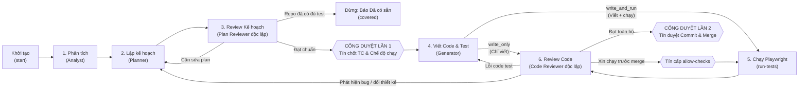

# vLearning-ts-version — Hướng Dẫn Vận Hành, Cài Đặt & AI QA Workflow

> Hệ thống kiểm thử tự động **API & Giao diện Web (UI)** cho dự án **vLearning (`Cybersoft`)**, vận hành bằng **Playwright + TypeScript** kết hợp **Đội ngũ AI Agent (`ai-engine/`)**, **Skills (`.agents/skills/`)** và **Cơ chế 2 lần duyệt bắt buộc của Tín**.

---

## 1. Các Phần Mềm Cần Tải & Lệnh Cài Đặt Để Chạy Repo (Từ Máy Mới)

Nếu bạn mới tải (clone) repo này về máy lần đầu, hãy cài theo thứ tự bảng dưới đây:

### 1.1. Danh sách công cụ cần cài đặt

| Công cụ                       | Bắt buộc?                           | Dùng để làm gì?                                                              | Link / Lệnh kiểm tra hoặc cài nhanh (macOS)              |
| ----------------------------- | ----------------------------------- | ---------------------------------------------------------------------------- | -------------------------------------------------------- |
| **Git**                       | **Bắt buộc**                        | Tải source code, quản lý nhánh và lịch sử thay đổi.                          | `git --version`                                          |
| **Node.js (>= 20)** & **npm** | **Bắt buộc**                        | Chạy Playwright TypeScript, kiểm tra lỗi code (`tsc`, `eslint`, `prettier`). | `node -v` (khuyên dùng Node 20 LTS trở lên)              |
| **Playwright Browsers**       | **Bắt buộc** (nếu chạy UI)          | Tải trình duyệt Chromium để chạy test giao diện web.                         | Cài qua `npx playwright install` ở bước dưới             |
| **Python 3.12 + `uv`**        | **Bắt buộc** (nếu dùng `ai-engine`) | Tạo môi trường ảo `.venv` cho bộ điều phối AI (`ai-engine/`).                | `brew install uv` _(hoặc cài từ `https://astral.sh/uv`)_ |
| **Java 17**                   | Tùy chọn                            | Chỉ cần khi muốn xuất và mở giao diện **Allure Report** ở máy cá nhân.       | `java -version` (CI dùng Java 17 Temurin)                |
| **k6**                        | Tùy chọn                            | Chỉ cần khi chạy kiểm thử hiệu năng (`npm run k6:smoke` / `k6:load`).        | `brew install k6`                                        |

### 1.2. Các bước cài đặt từng lệnh (Copy & Chạy theo thứ tự)

| Bước       | Mục đích                                                                                                 | Lệnh chạy tại thư mục gốc repo (`vLearning-ts-version`)                                |
| ---------- | -------------------------------------------------------------------------------------------------------- | -------------------------------------------------------------------------------------- |
| **Bước 1** | Tải thư viện Node.js (`@playwright/test`, `zod`, `faker`, `typescript`, `eslint`, `prettier`...)         | `npm ci` _(hoặc `npm install`)_                                                        |
| **Bước 2** | Tải trình duyệt cho Playwright _(trên Linux/CI thêm `--with-deps`)_                                      | `npx playwright install`                                                               |
| **Bước 3** | Cài môi trường Python & toàn bộ thư viện cho `ai-engine/` từ `uv.lock`                                   | `cd ai-engine && uv sync && cd ..`                                                     |
| **Bước 4** | Tạo file biến môi trường `.env` từ mẫu `.env.example` rồi điền `TOKEN_CYBERSOFT`, `USERNAME`, `PASSWORD` | `cp .env.example .env`                                                                 |
| **Bước 5** | Tạo phiên đăng nhập mẫu cho các UI test dùng quyền đăng nhập (`tests/ui/auth/*.setup.ts`)                | `npx playwright test --project=auth-setup`                                             |
| **Bước 6** | Chạy kiểm tra nhanh toàn hệ thống đã sẵn sàng chưa                                                       | `npm run check` và `cd ai-engine && .venv/bin/python -m unittest discover -s tests -v` |

---

## 2. Cách Vận Hành Repo Hằng Ngày (Từ A → Z)

Hệ thống vận hành theo **3 luồng hoạt động chính** tùy vào việc bạn đang muốn **chạy test có sẵn**, **nhờ AI viết test mới**, hay **theo dõi tự động trên GitHub**:

| Luồng vận hành                                                              | Ai thực hiện?                      | Quy trình thực tế diễn ra như thế nào?                                                                                                                                                                                                                                                                                                                                                                                                                             |
| --------------------------------------------------------------------------- | ---------------------------------- | ------------------------------------------------------------------------------------------------------------------------------------------------------------------------------------------------------------------------------------------------------------------------------------------------------------------------------------------------------------------------------------------------------------------------------------------------------------------ |
| **Luồng A: Chạy test có sẵn & xem báo cáo**                                 | QA / Dev / Người vận hành          | 1. Mở terminal tại gốc repo (hoặc mở tab **Testing** trong VS Code/Antigravity IDE).<br>2. Chạy `npm run test:api` hoặc `npm run test:ui` (hoặc bấm nút Play `▶` cạnh từng test).<br>3. Nếu UI test cần đăng nhập sẵn mà chưa có phiên, chạy `npx playwright test --project=auth-setup` trước.<br>4. Xem kết quả qua `npm run test:report` (Playwright HTML) hoặc `npm run allure:generate && npm run allure:open` (Allure).                                       |
| **Luồng B: Dùng AI Agent viết / review test mới**                           | Tín + AI (`vlearning-qa-workflow`) | 1. Đưa yêu cầu (requirement, ảnh Swagger, JSON mẫu, manual TC hoặc nguồn NotebookLM) cho Antigravity hoặc CLI.<br>2. AI chạy pha chỉ đọc: `analyze` → `plan` → `review_plan` độc lập.<br>3. **Tín Duyệt lần 1** (chọn TC + chế độ `write_only` hoặc `write_and_run`).<br>4. AI triển khai vào đúng file được phép (`generate`), chạy test (nếu `write_and_run`) và gửi `Code Reviewer` độc lập kiểm chứng.<br>5. **Tín Duyệt lần 2** để commit / merge nhánh đích. |
| **Luồng C: Tự động hóa trên CI/CD (`.github/workflows/playwright-ci.yml`)** | GitHub Actions tự động             | • **Tự chạy** khi push/PR vào `main`/`master`, chạy định kỳ mỗi ngày lúc **16:00 (giờ VN)** hoặc bấm chạy tay (`workflow_dispatch`).<br>• Các bước trên CI: `npm ci` → `npx playwright install --with-deps` → `npm run check` → `npm run test` → tạo Allure Report → deploy lên **GitHub Pages** → chạy `scripts/generate-slack-report.js` gửi báo cáo về **Slack**.                                                                                               |

---

## 3. Ý Nghĩa Toàn Bộ File & Folder Trong Repo

### 3.1. Cấu trúc cấp gốc của dự án

| File / Folder                                                    | Giải thích dễ hiểu cho người không chuyên code         | Chi tiết kỹ thuật                                                                                                    |
| ---------------------------------------------------------------- | ------------------------------------------------------ | -------------------------------------------------------------------------------------------------------------------- |
| **`src/`**                                                       | **Kho công cụ & linh kiện dùng chung**                 | Chứa code nền để các file test gọi lại (API client, Page Objects, schema, dữ liệu mẫu, helper), tránh viết lặp lại.  |
| **`tests/`**                                                     | **Nơi chứa các kịch bản test (Test Cases)**            | Chia làm 2 nhóm chạy chính: `tests/api/` (test API) và `tests/ui/` (test giao diện trình duyệt).                     |
| **`ai-engine/`**                                                 | **Bộ não điều phối AI Agent**                          | Chương trình Python quản lý trạng thái từng task QA, nạp prompt/rule, khóa phạm vi sửa file và chạy Playwright JSON. |
| **`.agents/`**                                                   | **Sổ tay kỹ năng & Chốt khóa bảo vệ**                  | Chứa 10 skills hướng dẫn AI (`.agents/skills/`) và chốt chặn `workflow_guard.py` (`.agents/hooks/`).                 |
| **`.github/`**                                                   | **Kịch bản chạy tự động trên GitHub**                  | Chứa `workflows/playwright-ci.yml` để chạy test, xuất Allure Report và gửi thông báo Slack tự động.                  |
| **`scripts/`**                                                   | **Kịch bản phụ trợ cho báo cáo CI**                    | Chứa `generate-slack-report.js` tổng hợp kết quả test tạo file `slack-payload.json`.                                 |
| **`playwright/`**                                                | **Nơi lưu phiên đăng nhập mẫu của trình duyệt**        | Chứa thư mục `.auth/` lưu file `storageState` sau khi chạy `auth-setup` để các UI test tái sử dụng phiên admin.      |
| **`reports/`**                                                   | **Nơi lưu kết quả báo cáo sau khi chạy test**          | Chứa báo cáo Playwright (`html/`, `junit/`, `test-results/`) và `allure-results/` / `allure-report/` (đã gitignore). |
| **`AGENTS.md`**                                                  | **Bản nội quy chính của repo dành cho AI**             | Quy định tiếng Việt, cơ chế 2 lần duyệt, quyền NotebookLM chỉ đọc và thứ tự ưu tiên giữa các skill.                  |
| **`README.md`**                                                  | **Tài liệu hướng dẫn tổng hợp (chính là file này)**    | Hướng dẫn cài đặt, vận hành, cấu trúc thư mục, luồng AI workflow và bộ rule chuẩn.                                   |
| **`playwright.config.ts`**                                       | **Bảng điều khiển cấu hình Playwright**                | Định nghĩa URL mặc định, timeout `30s`, bật trace/screenshot khi fail và chia 3 project: `api`, `auth-setup`, `ui`.  |
| **`package.json` & `package-lock.json`**                         | **Danh bạ thư viện & nút bấm lệnh `npm run ...`**      | Khai báo các thư viện Node.js cần cài và các lệnh tắt (`test:api`, `test:ui`, `check`, `allure:generate`...).        |
| **`tsconfig.json`**                                              | **Cấu hình kiểm tra kiểu chữ/kiểu dữ liệu TypeScript** | Giúp bắt sớm lỗi gõ sai tên biến, sai kiểu tham số qua `npx tsc --noEmit`.                                           |
| **`eslint.config.js`**, **`.prettierrc`**, **`.prettierignore`** | **Bộ chuẩn dọn đẹp & bắt lỗi cú pháp code**            | Đảm bảo toàn bộ repo viết code đồng nhất một phong cách (`npm run lint`, `npm run format:check`).                    |
| **`.env` & `.env.example`**                                      | **File chứa cấu hình & mật khẩu môi trường**           | `.env.example` là bản mẫu an toàn trên Git; `.env` chứa token/tài khoản thật trên máy (bị ẩn khỏi Git).              |
| **`.gitignore`**                                                 | **Danh sách những thứ không được đẩy lên GitHub**      | Ẩn `node_modules/`, `.env`, `reports/`, `logs/`, `ai-engine/tasks/`, `ai-engine/.venv/`, `__pycache__/`, `*.pyc`.    |
| **`.notebooklm/`**                                               | **Cấu hình kết nối NotebookLM cục bộ**                 | Hỗ trợ skill `notebooklm` đọc tài liệu dự án (mặc định chỉ đọc).                                                     |
| **`slack-payload.json`**                                         | **File nội dung báo cáo gửi sang Slack**               | Được sinh ra bởi `scripts/generate-slack-report.js` trong quá trình chạy CI.                                         |

### 3.2. Chi tiết bên trong `src/` (Kho công cụ)

| Thư mục con trong `src/` | Vai trò trong dây chuyền kiểm thử                                                                           | Ví dụ file thực tế                                                                                                               |
| ------------------------ | ----------------------------------------------------------------------------------------------------------- | -------------------------------------------------------------------------------------------------------------------------------- |
| **`src/api/`**           | Gửi request API thực tế và kiểm tra response cơ bản.                                                        | `clients/api-client.ts`, `services/auth.service.ts`, `course.service.ts`, `user.service.ts`, `assertions/response.assertion.ts`. |
| **`src/config/`**        | Đọc các biến trong `.env` thành đối tượng `env` an toàn.                                                    | `env.config.ts` (`baseUrl`, `apiBaseUrl`, `tokenCybersoft`, `defaultGroup`).                                                     |
| **`src/data/`**          | Sinh dữ liệu ngẫu nhiên hợp lệ để mỗi lần chạy test không bị trùng dữ liệu.                                 | `course.data.ts`, `user.data.ts`.                                                                                                |
| **`src/endpoints/`**     | Lưu danh sách đường dẫn URL của API và Web UI ở một chỗ tập trung.                                          | `api-endpoints/` (`auth`, `course`, `user`) và `ui-endpoints/` (`auth`, `homePage`).                                             |
| **`src/fixtures/`**      | Bơm sẵn service API và Page Object vào từng test (`test`, `expect`).                                        | `api.fixture.ts`, `ui.fixture.ts`.                                                                                               |
| **`src/helpers/`**       | Hàm tiện ích dùng chung: chuẩn bị dữ liệu `beforeEach`, dọn dữ liệu `afterEach`, log và đính kèm report.    | `common.helper.ts`, `cleanup.helper.ts`, `api-report.helper.ts`, `logger.helper.ts`, `random.helper.ts`.                         |
| **`src/pages/`**         | Mô hình Page Object Model (POM) đại diện từng màn hình web (tách `*.type.ts`, `*.button.ts`, `*.index.ts`). | `basePage/`, `authPage/`, `homePage/`, `adminPage/`, `thongTinCaNhanPage/`.                                                      |
| **`src/schemas/`**       | Khuôn mẫu Zod kiểm tra cấu trúc JSON API trả về có đúng kiểu và đủ trường hay không.                        | `auth.schema.ts`, `course.schema.ts`, `user.schema.ts`.                                                                          |
| **`src/types/`**         | Định nghĩa kiểu dữ liệu TypeScript dùng chung cho toàn dự án.                                               | `common.type.ts` (`PaginationQuery`), `auth.type.ts`, `course.type.ts`, `user.type.ts`.                                          |

### 3.3. Chi tiết bên trong `tests/`, `ai-engine/` và `.agents/`

| Thư mục          | Các thành phần con & Ý nghĩa                                                                                                                                                                                                                                                                                                                                                                                                                                                                         |
| ---------------- | ---------------------------------------------------------------------------------------------------------------------------------------------------------------------------------------------------------------------------------------------------------------------------------------------------------------------------------------------------------------------------------------------------------------------------------------------------------------------------------------------------- |
| **`tests/api/`** | Chia theo 3 nhóm nghiệp vụ API: `auth/`, `courses/` (ví dụ `getCourseListPaging.api.spec.ts`), `users/`.                                                                                                                                                                                                                                                                                                                                                                                             |
| **`tests/ui/`**  | `auth/*.setup.ts` (tạo phiên đăng nhập) và các spec giao diện: `home/` (ví dụ `searchCourse.ui.spec.ts`), `login/`, `register/`, `users/`.                                                                                                                                                                                                                                                                                                                                                           |
| **`ai-engine/`** | • `pyproject.toml` & `uv.lock`: khóa phiên bản Python `3.12` và thư viện cho `.venv`.<br>• `config/agents.toml`: nối từng vai trò AI với file prompt.<br>• `vlearning_agent/cli.py`, `orchestrator.py`, `models.py`: bộ máy trạng thái, kiểm tra JSON bàn giao.<br>• `vlearning_agent/agents/prompts/`: bộ luật và hướng dẫn cho 5 vai trò AI.<br>• `tasks/`: lưu trạng thái từng task (`TASK-001`, `TASK-002`...) — không đẩy lên Git.<br>• `tests/`: 21 unit tests kiểm chứng bộ điều phối Python. |
| **`.agents/`**   | • `hooks.json` + `hooks/workflow_guard.py`: chốt chặn kỹ thuật ngăn sửa nhầm `src/`/`tests/` khi chưa duyệt.<br>• `skills/`: 10 thư mục skill hướng dẫn Antigravity phối hợp công việc.                                                                                                                                                                                                                                                                                                              |

---

## 4. Cách Sử Dụng AI Agent Trong `ai-engine/`

Hệ thống hỗ trợ **2 cách sử dụng** dùng chung một bộ quy tắc và cho ra **cùng một chuẩn kết quả**:

| Tiêu chí             | Cách 1: Nhắn trực tiếp qua Antigravity (Khuyên dùng)                                                                           | Cách 2: Chạy bằng lệnh Terminal (`CLI`)                                                                       |
| -------------------- | ------------------------------------------------------------------------------------------------------------------------------ | ------------------------------------------------------------------------------------------------------------- |
| **Phù hợp với ai?**  | Người làm QA / BA / quản lý **không cần nhớ lệnh code**, chỉ cần mô tả yêu cầu bằng tiếng Việt.                                | Kỹ sư muốn tự động hóa từ dòng lệnh hoặc tích hợp vào kịch bản terminal.                                      |
| **Cách bắt đầu**     | Mở chat Antigravity và gửi yêu cầu (kèm text, ảnh Swagger, JSON mẫu hoặc link/nguồn NotebookLM).                               | Chạy lệnh `cli.py --task <MÃ_TASK> start ...` từ thư mục gốc repo.                                            |
| **Cách AI phối hợp** | Antigravity tự gọi lần lượt các subagent độc lập, cập nhật trạng thái vào `ai-engine/` và dừng lại hỏi Tín ở **2 cổng duyệt**. | Dùng cờ `--auto` hoặc `run-plan` / `next` để Python gọi trực tiếp `google-antigravity` SDK (`sdk_runner.py`). |
| **Điều kiện cần**    | Đã mở workspace trong Antigravity App / IDE.                                                                                   | Đã cài `ai-engine/.venv` (`uv sync`) và đặt `GEMINI_API_KEY` (hoặc Vertex AI) trong shell / `.env`.           |

### 4.1. Ví dụ câu lệnh chat cho người dùng (Cách 1)

| Bạn muốn làm gì?                            | Bạn chỉ cần nhắn như sau                                                                                                                                                 |
| ------------------------------------------- | ------------------------------------------------------------------------------------------------------------------------------------------------------------------------ |
| **Kiểm tra & viết test từ mô tả nghiệp vụ** | _"Áp dụng `vlearning-qa-workflow` cho nhiệm vụ `TASK-001`: kiểm tra API/UI cho case đăng nhập sai mật khẩu, chạy bước phân tích và lập kế hoạch trình tôi duyệt lần 1."_ |
| **Viết API test từ ảnh Swagger + JSON mẫu** | _"Dựa vào ảnh Swagger và response JSON mẫu này cho API `/api/...`, hãy phân tích test case, lập kế hoạch và review độc lập trước khi trình tôi duyệt."_                  |
| **Viết UI test từ các bước thao tác web**   | _"Requirement UI test: 1. Mở trang chủ... 2. Nhập tên khóa học... 3. Click Xem chi tiết... Hãy viết 1 TC happy case UI theo quy trình."_                                 |
| **Chốt Duyệt lần 1 (Gate 1)**               | _"Duyệt đợt `B1` gồm `TC_001, TC_002` theo chế độ `write_and_run` (hoặc `write_only`)."_                                                                                 |
| **Chốt Duyệt lần 2 (Gate 2)**               | _"Đã kiểm tra ổn, duyệt merge nhánh / giữ diff trên `main`."_                                                                                                            |

### 4.2. Bảng lệnh CLI trong `ai-engine/` (Cách 2 & quản lý hồ sơ)

Mọi lệnh đều chạy từ thư mục gốc dự án theo cú pháp:

```bash
PYTHONPATH=ai-engine ai-engine/.venv/bin/python -m vlearning_agent.cli --task <TASK_ID> <LỆNH>
```

| Lệnh                                                                                      | Ý nghĩa dễ hiểu                                                                                                                | Khi nào dùng?                                                  |
| ----------------------------------------------------------------------------------------- | ------------------------------------------------------------------------------------------------------------------------------ | -------------------------------------------------------------- |
| `start --requirement "..." --query "..." --target main --guide api [--guide ui] [--auto]` | Mở hồ sơ nhiệm vụ mới, quét nhanh xem repo đã có test tương tự chưa. Thêm `--auto` để chạy tự động tới lúc trình duyệt.        | Khi bắt đầu một nhiệm vụ mới.                                  |
| `prompt [--notebook-id ID --source-id SID]`                                               | Xuất trọn bộ quy tắc + ngữ cảnh + cấu trúc JSON đầu ra cho bước hiện tại.                                                      | Trước khi giao việc cho một vai trò AI.                        |
| `submit --input <file.json>` _(hoặc `--input -`)_                                         | Nộp kết quả của một bước, tự động kiểm tra định dạng chuẩn và chuyển sang bước tiếp theo.                                      | Sau khi một vai trò AI hoàn thành.                             |
| `run-plan` / `next`                                                                       | Nhờ Python SDK tự chạy vòng lập kế hoạch (`run-plan`) hoặc chạy đúng 1 bước kế tiếp (`next`).                                  | Khi dùng chế độ chạy tự động ở Terminal.                       |
| `approve-plan --version N --batch B1 --case TC1 --mode write_and_run --decision "..."`    | **Ghi nhận Tín Duyệt lần 1**, mở khóa quyền sửa đúng các file đã duyệt _(chọn `--mode` là `write_only` hoặc `write_and_run`)_. | Sau khi Tín xem xong Kế hoạch & Review Kế hoạch.               |
| `run-tests`                                                                               | Tự động chạy đúng từng lệnh Playwright đã duyệt và lưu báo cáo JSON (`run-*.json`).                                            | Ở bước chạy kiểm thử (`write_and_run` hoặc `checks`).          |
| `allow-checks --commit <SHA> --decision "..."`                                            | Cấp quyền chạy test thật cho đợt trước đó mới chọn `write_only`.                                                               | Khi muốn chạy kiểm tra lại đợt `write_only` trước merge.       |
| `approve-merge --commit <SHA> --source <src> --target <tgt> --decision "..."`             | **Ghi nhận Tín Duyệt lần 2**, gộp nhánh nguồn vào nhánh đích và đóng nhiệm vụ.                                                 | Sau khi code và kết quả chạy test đã đạt.                      |
| `status` / `report` / `scan`                                                              | Xem trạng thái JSON / in báo cáo tiếng Việt / quét lại `tests/`.                                                               | Bất cứ lúc nào cần kiểm tra tiến độ.                           |
| `activate` / `deactivate`                                                                 | Bật hoặc tạm tắt chốt bảo vệ `workflow_guard.py` cho `<TASK_ID>` (giữ nguyên code đã làm).                                     | Khi chuyển sang nhiệm vụ khác mà muốn giữ lại code thử nghiệm. |

---

## 5. Luồng Workflow 2 Lần Duyệt & Phối Hợp 5 Vai Trò AI

Mỗi nhiệm vụ đi qua **6 bước chuẩn** và **2 cổng phê duyệt bắt buộc của Tín** — AI không được phép tự duyệt thay ở bất kỳ cổng nào:



### 5.1. Chi tiết nhiệm vụ & giới hạn quyền của từng vai trò AI

| Bước                 | Tên vai trò (Subagent)                        | Việc vai trò này phải làm                                                                                                                                                         | Giới hạn / Cấm kỵ bắt buộc                                                                                                             |
| -------------------- | --------------------------------------------- | --------------------------------------------------------------------------------------------------------------------------------------------------------------------------------- | -------------------------------------------------------------------------------------------------------------------------------------- |
| **1. `analyze`**     | **Analyst** (`vlearning-analyst`)             | Đọc yêu cầu, ảnh Swagger, hoặc khảo sát DOM thật; tách thành từng hành vi rõ ràng; liệt kê câu hỏi mở nếu thiếu dữ liệu (như mã lỗi HTTP chưa quy định).                          | Không được tự đoán mã lỗi hoặc bịa hành vi; không sửa code và không chạy test.                                                         |
| **2. `plan`**        | **Planner** (`vlearning-planner`)             | Rà soát `src/` và `tests/` xem cái gì **Dùng lại**, cái gì **Sửa**, cái gì **Tạo mới**; viết trước toàn bộ code dự kiến; chia đợt chạy (`B1`, `B2`...).                           | **Cấm** sửa file thật trong `src/`, `tests/` và **cấm** chạy Playwright.                                                               |
| **3. `review_plan`** | **Plan Reviewer** (`vlearning-plan-reviewer`) | Mở một phiên **độc lập hoàn toàn (context sạch)**, tự đọc file repo thật, mô phỏng `chuẩn bị → thao tác → kiểm tra → dọn dẹp`, kiểm tra xem repo đã có test phủ chưa (`covered`). | Không được sửa file (`EnableWriteTools: false`); nếu kế hoạch vi phạm rule hoặc thiếu kiểm tra thì trả về Planner sửa lại.             |
| **4. `generate`**    | **Generator** (`vlearning-generator`)         | Chỉ chạy **sau Duyệt lần 1**; triển khai code và test đúng như kế hoạch đã duyệt, kiểm tra biên dịch `npx tsc --noEmit`.                                                          | Chỉ được sửa/tạo **đúng danh sách file trong `writable_paths`**; nếu phát sinh file ngoài phạm vi phải xin duyệt lại.                  |
| **5. `run`**         | **Test Runner** (`cli.py run-tests`)          | Chạy đúng từng lệnh Playwright theo `--project=api` / `--project=ui`, `--grep <MÃ_TC>`, `--reporter=json` và lưu log kết quả.                                                     | Chỉ chạy khi đợt được duyệt `write_and_run` (hoặc sau khi Tín cấp `allow-checks`).                                                     |
| **6. `review_code`** | **Code Reviewer** (`vlearning-code-reviewer`) | Mở phiên **độc lập hoàn toàn (context sạch)**, đối chiếu diff thật với kế hoạch, kiểm tra assertion có bắt được lỗi sản phẩm không, kiểm tra kết quả chạy thật & cleanup.         | Không được sửa file; nếu test fail do lỗi sản phẩm (backend/UI bug), **giữ nguyên assertion** và báo cáo trung thực để Tín quyết định. |

### 5.2. Hai chế độ triển khai để Tín lựa chọn ở Duyệt lần 1

| Chế độ                            | Ý nghĩa                                                                                                   | Khi nào nên chọn?                                                                                              |
| --------------------------------- | --------------------------------------------------------------------------------------------------------- | -------------------------------------------------------------------------------------------------------------- |
| **`write_only` (Chỉ viết)**       | AI chỉ viết/sửa code xong rồi chuyển sang Review Code tĩnh, **chưa chạy Playwright** ngay.                | Khi môi trường server đang bảo trì, chưa có dữ liệu test, hoặc Tín muốn tự chạy kiểm tra sau (`allow-checks`). |
| **`write_and_run` (Viết + chạy)** | AI viết xong sẽ **chạy thật Playwright** tới server/web và đính kèm kết quả chạy vào báo cáo Review Code. | Khi muốn xác minh test chạy xanh thật (hoặc phát hiện bug thật của hệ thống) ngay trong một lượt.              |

---

## 6. Tương Tác Giữa AI Engine, Skills (`.agents/skills/`), `src/` và `tests/`

### 6.1. Danh sách 10 Skills trong `.agents/skills/` & Thứ tự ưu tiên

> [!IMPORTANT]
> **Quy tắc ưu tiên cao nhất**: Nếu có bất kỳ xung đột nào giữa các skill kỹ thuật tổng quát (ví dụ `playwright-best-practices` khuyên chạy test ngay sau khi sửa code) với quy định của dự án (**`vlearning-qa-workflow`**, **`AGENTS.md`**, **`project-rules.md`**), **quy trình 2 lần duyệt của vLearning luôn được ưu tiên áp dụng**.

| Tên Skill                       | Hiểu đơn giản là gì?                               | Tương tác với bước nào trong quy trình?                            | Lưu ý quan trọng                                                                                |
| ------------------------------- | -------------------------------------------------- | ------------------------------------------------------------------ | ----------------------------------------------------------------------------------------------- |
| **`vlearning-qa-workflow`**     | **Nhạc trưởng điều phối quy trình 2 lần duyệt**    | Xuyên suốt từ `start` → `Gate 1` → `generate/run` → `Gate 2`.      | Luôn kích hoạt khi làm requirement, manual TC hoặc viết/review test vLearning.                  |
| **`playwright-best-practices`** | Sổ tay kỹ thuật viết Playwright sạch, ít flaky     | Bước `plan` và `generate` (cách chờ, locator, cấu trúc assertion). | Tuân thủ `writable_paths` và chế độ chạy của `vlearning-qa-workflow`.                           |
| **`playwright-cli`**            | Công cụ mở trình duyệt khảo sát giao diện thực tế  | Bước `analyze` và `plan` cho UI test.                              | Dùng để soi DOM, placeholder, URL thật trên web trước khi đặt locator.                          |
| **`systematic-debugging`**      | Phương pháp điều tra lỗi tận gốc                   | Bước `run` / `review_code` khi có test fail.                       | Phân biệt rõ: lỗi code test, lỗi dữ liệu setup, lỗi mạng sandbox hay **bug thật của sản phẩm**. |
| **`notebooklm`**                | Kết nối đọc tài liệu từ Google NotebookLM          | Bước `analyze` và `plan` khi Tín đưa nguồn NotebookLM.             | **Mặc định chỉ đọc**; mọi thao tác thêm/sửa/xóa nguồn phải trình Tín duyệt riêng.               |
| **`qa-test-plan`**              | Lập kế hoạch kiểm thử theo rủi ro cho PR/commit    | Hỗ trợ đánh giá tác động thay đổi trước khi phát hành.             | Không thay thế bước duyệt của Tín.                                                              |
| **`drift-testing`**             | Kiểm thử API đối chiếu chuẩn OpenAPI/AsyncAPI spec | Tham khảo khi đối chiếu contract API.                              | Chạy độc lập qua Drift CLI.                                                                     |
| **`gh-fix-ci`**                 | Kiểm tra và sửa lỗi GitHub Actions CI              | Khi check CI trong `.github/workflows/` bị đỏ trên PR.             | Chỉ sửa sau khi có xác nhận kế hoạch sửa.                                                       |
| **`web-accessibility-testing`** | Kiểm tra chuẩn truy cập giao diện (WCAG 2.2 AA)    | Khi có yêu cầu test accessibility (`axe-core`).                    | Bổ trợ cho UI test.                                                                             |
| **`skill-creator`**             | Hướng dẫn tạo hoặc tối ưu skill mới                | Khi mở rộng hệ thống skill trong `.agents/skills/`.                | Dùng riêng cho bảo trì bộ skill.                                                                |

### 6.2. Đường đi thực tế của một Test Case qua `src/` và `tests/`

| Loại Test                      | Luồng đi chuẩn trong code (`src/` → `tests/`)                                                                                                                                                                                                                                                                                            | Cơ chế chuẩn bị & dọn dẹp dữ liệu                                                                                                                                                                                   |
| ------------------------------ | ---------------------------------------------------------------------------------------------------------------------------------------------------------------------------------------------------------------------------------------------------------------------------------------------------------------------------------------- | ------------------------------------------------------------------------------------------------------------------------------------------------------------------------------------------------------------------- |
| **API Test** (`--project=api`) | `tests/api/<nhóm>/*.api.spec.ts` → gọi `api.fixture.ts` (cấp `authService`, `courseService`, `userService`) → gọi endpoint trong `src/endpoints/api-endpoints/` qua `ApiClient` (tự gắn `TokenCybersoft`) → đính kèm log `attachApiRequestResponse` → kiểm tra status, content-type, schema Zod (`src/schemas/`) và assertion nghiệp vụ. | `beforeEach` gọi helper trong `src/helpers/common.helper.ts` tạo dữ liệu cô lập; **ghi nhận ID ngay khi API trả `200`** để `afterEach` gọi `src/helpers/cleanup.helper.ts` xóa sạch kể cả khi test fail giữa chừng. |
| **UI Test** (`--project=ui`)   | `tests/ui/<màn hình>/*.ui.spec.ts` → gọi `ui.fixture.ts` (cấp Page Object + cả API services) → gọi thao tác tại `<page>.index.ts` (kế thừa `BasePage`) → dùng locator tại `<page>.button.ts` + kiểu dữ liệu tại `<page>.type.ts` + URL tại `src/endpoints/ui-endpoints/` → kiểm tra UI & URL đích.                                       | Nếu cần khóa học / tài khoản riêng để test UI ổn định, `beforeEach` tạo qua API (`common.helper.ts`), tương tác kiểm thử thuần túy trên UI, và `afterEach` xóa sạch qua API (`cleanup.helper.ts`).                  |

---

## 7. Toàn Bộ Bộ Quy Tắc Đã Setup (`AGENTS.md`, `project-rules.md`, `review-plan.md`, `review-code.md`)

Tất cả các quy tắc dưới đây được tự động nạp vào prompt của AI mỗi lần chạy và được **Plan Reviewer** + **Code Reviewer** đối chiếu bắt buộc:

### 7.1. Quy tắc điều phối, ngôn ngữ, bằng chứng & quyền hạn

| Quy tắc                                    | Nội dung bắt buộc                                                                                                                                                                                                          |
| ------------------------------------------ | -------------------------------------------------------------------------------------------------------------------------------------------------------------------------------------------------------------------------- |
| **Ngôn ngữ & Định danh**                   | Giao tiếp, báo cáo, comment giải thích logic và assertion hoàn toàn bằng **tiếng Việt**. Giữ nguyên mã TC, mã requirement, tên file, tên hàm để đối chiếu trực tiếp.                                                       |
| **Trung thực bằng chứng**                  | Phân biệt rõ _hành vi được yêu cầu_, _hành vi quan sát được_ và _giả định_. Nếu hai nguồn mâu thuẫn, trích dẫn cả hai và hỏi Tín xác nhận.                                                                                 |
| **Chốt chặn bảo vệ (`workflow_guard.py`)** | Trước Duyệt lần 1: **cấm** sửa `src/`, `tests/`, `playwright.config.ts`, `package.json` và **cấm** chạy Playwright. Sau Duyệt lần 1: **cấm** sửa ngoài `writable_paths` và **cấm** tự ý merge khi chưa có `approve-merge`. |
| **Reviewer độc lập**                       | `plan_reviewer` và `code_reviewer` **bắt buộc** chạy trên subagent mới với ngữ cảnh sạch, tự đọc code/diff/report thật.                                                                                                    |
| **Tìm trước khi tạo & Nghĩa nghiệp vụ**    | Luôn tìm code sẵn có trong repo trước khi thêm mới; giữ đúng 3 nhóm API `auth`, `course`, `user`; phân biệt đúng: **“đăng ký”** = tạo yêu cầu chờ duyệt, **“ghi danh”** = đã xét duyệt.                                    |
| **NotebookLM chỉ đọc**                     | Chỉ đọc nguồn NotebookLM (ghi rõ tiêu đề, `source_id`, vị trí đoạn); mọi đề xuất thêm/sửa/xóa nguồn phải trình Tín duyệt riêng.                                                                                            |

### 7.2. Quy ước TypeScript trong `src/types/`

| Quy tắc                           | Cách áp dụng chuẩn trong repo                                                                                                                                        | Ví dụ thực tế                                                                    |
| --------------------------------- | -------------------------------------------------------------------------------------------------------------------------------------------------------------------- | -------------------------------------------------------------------------------- |
| **Tổ chức theo mục đánh số**      | Mục `1` luôn là `INTERFACE GỐC - CHỨA TOÀN BỘ FIELD`; các mục `2, 3, ...` bên dưới định nghĩa từng Request/Response/Params cụ thể.                                   | Xem [course.type.ts](src/types/course.type.ts)                                   |
| **Tái sử dụng, không viết trùng** | Kế thừa field từ interface gốc (`CourseData`, ...) và các type dùng chung ở `src/types/common.type.ts` (`PaginationQuery`, ...) bằng `Pick`, `Omit`, `Partial`, `&`. | `Partial<Pick<CourseData, 'tenKhoaHoc'> & PaginationQuery & { MaNhom: string }>` |
| **Không để nhãn tạm**             | Tuyệt đối không giữ nhãn `[MỚI]` trong comment của source code thật.                                                                                                 | Bỏ `[MỚI]` khi chuyển từ bản nháp Plan sang code thật.                           |

### 7.3. Quy ước Page Object Model (POM) trong `src/pages/`

Mỗi màn hình trong `src/pages/.../<pageName>/` phải tách thành **3 file chuẩn** (tham chiếu `homeHeaderHomePage/` và `searchCourseHomePage/`):

| File trong folder POM      | Trách nhiệm                                           | Quy tắc viết bắt buộc                                                                                                                                                                                                                                                                                                                                                            |
| -------------------------- | ----------------------------------------------------- | -------------------------------------------------------------------------------------------------------------------------------------------------------------------------------------------------------------------------------------------------------------------------------------------------------------------------------------------------------------------------------- |
| **`<pageName>.type.ts`**   | Chứa các kiểu dữ liệu riêng của màn hình đó.          | Khai báo union type cho tên nút, link, menu, thông báo lỗi/thành công hoặc kiểu URL mong đợi (`SearchCourseCardAction = 'Xem chi tiết'`).                                                                                                                                                                                                                                        |
| **`<pageName>.button.ts`** | Chỉ chứa locator của màn hình đó, chia rõ **2 nhóm**. | • **`//locator type 1`**: Locator cố định không tham số → khai báo `readonly <ten>: Locator;` và gán trong `constructor(private readonly page: Page)`.<br>• **`//locator type 2`**: Locator động có cùng format chỉ khác `name`/text bên trong → viết thành method nhận tham số (ưu tiên truyền union type từ `<pageName>.type.ts` + tên động runtime như `courseName: string`). |
| **`<pageName>.index.ts`**  | Thực hiện hành động & kiểm tra trên màn hình.         | Kế thừa `BasePage`, gọi locator từ `this.button...`, không viết selector thô trực tiếp trong spec.                                                                                                                                                                                                                                                                               |

### 7.4. Quy ước File Test, Helper, Hook & `test.describe` trong `tests/`

| Quy tắc                                      | Nội dung bắt buộc (tham chiếu `updateCourse.api.spec.ts` & `searchCourse.ui.spec.ts`)                                                                                                                                                                                                                                              |
| -------------------------------------------- | ---------------------------------------------------------------------------------------------------------------------------------------------------------------------------------------------------------------------------------------------------------------------------------------------------------------------------------- |
| **Không viết helper cục bộ trong file test** | Toàn bộ hàm chuẩn bị dữ liệu cho `beforeEach` phải đặt ở **`src/helpers/common.helper.ts`**; toàn bộ hàm dọn dẹp cho `afterEach` phải đặt ở **`src/helpers/cleanup.helper.ts`**. Trong file test, `beforeEach` và `afterEach` **chỉ import để gọi lại**.                                                                           |
| **Chỉ 1 `test.describe` cha**                | Mỗi file spec chỉ có **duy nhất 1 `test.describe` cha**. Mọi biến dùng chung (`let accessToken = '';`, `let createdCourseIds: string[] = [];`, `let createdCourse...`) phải đặt **bên trong `test.describe` cha** để toàn bộ file/nhóm con dùng chung.                                                                             |
| **Quy tắc tách `test.describe` con**         | Không tự tách nhiều `test.describe` con chỉ để chia chủ đề nếu các test dùng chung một hook. Chỉ tạo **1 `test.describe` con** cho mỗi nhóm có điều kiện `beforeEach`/`afterEach` khác biệt hoàn toàn với mọi nhóm con còn lại: _(1) nhóm có hook_, _(2) nhóm không có hook_, hoặc _(3) nhóm có điều kiện setup/cleanup khác hẳn_. |
| **Comment tiếng Việt & Cleanup an toàn**     | Mỗi khối logic (`Setup`, `Arrange`, `Act`, `Report`, `Schema`, `Assert`, `Cleanup`) có comment tiếng Việt nêu rõ mục đích và hành vi chứng minh. Khi tạo nhiều tài nguyên ở API setup, ghi nhận ID ngay khi status `200` trước khi chạy bước tiếp theo.                                                                            |

---

## 8. Bảng Tham Chiếu `.env` & Lệnh Kiểm Tra Hằng Ngày

### 8.1. Biến môi trường trong `.env`

| Biến                                  | Mục đích                                                   | Giá trị mặc định / Ghi chú                                 |
| ------------------------------------- | ---------------------------------------------------------- | ---------------------------------------------------------- |
| `BASE_URL`                            | Địa chỉ trang web UI cần test                              | `https://demo2.cybersoft.edu.vn`                           |
| `API_BASE_URL`                        | Địa chỉ máy chủ API                                        | `https://elearningnew.cybersoft.edu.vn`                    |
| `TOKEN_CYBERSOFT`                     | Token bắt buộc trong header mọi API                        | Lấy từ Swagger / hệ thống Cybersoft (không commit lên Git) |
| `USERNAME` / `PASSWORD`               | Tài khoản quản trị dùng cho setup/cleanup                  | Cấu hình trong `.env` (không commit lên Git)               |
| `DEFAULT_GROUP` / `DEFAULT_COURSE_ID` | Mã nhóm & mã khóa học mặc định                             | `GP01` / `000`                                             |
| `GEMINI_API_KEY`                      | Khóa xác thực (chỉ cần nếu chạy AI bằng Terminal `--auto`) | Không cần nếu chat trực tiếp qua Antigravity               |

### 8.2. Bảng lệnh kiểm tra nhanh

| Mục đích                                                   | Lệnh chạy (từ thư mục gốc repo)                                                   |
| ---------------------------------------------------------- | --------------------------------------------------------------------------------- |
| **Kiểm tra lỗi TypeScript toàn dự án**                     | `npm run type-check` _(hoặc `npx tsc --noEmit`)_                                  |
| **Kiểm tra TypeScript + ESLint + Prettier**                | `npm run check`                                                                   |
| **Tạo phiên đăng nhập mẫu cho UI test**                    | `npx playwright test --project=auth-setup`                                        |
| **Chạy toàn bộ API test**                                  | `npm run test:api`                                                                |
| **Chạy toàn bộ UI test**                                   | `npm run test:ui`                                                                 |
| **Chạy 1 file test cụ thể & mở trình duyệt xem trực tiếp** | `npx playwright test tests/ui/home/searchCourse.ui.spec.ts --project=ui --headed` |
| **Xem danh sách các test case Playwright nhận diện**       | `npx playwright test --list`                                                      |
| **Mở báo cáo Playwright HTML**                             | `npm run test:report`                                                             |
| **Tạo & mở báo cáo Allure (cần Java 17)**                  | `npm run allure:generate && npm run allure:open`                                  |
| **Chạy bộ unit test của AI Engine (Python)**               | `cd ai-engine && .venv/bin/python -m unittest discover -s tests -v`               |
